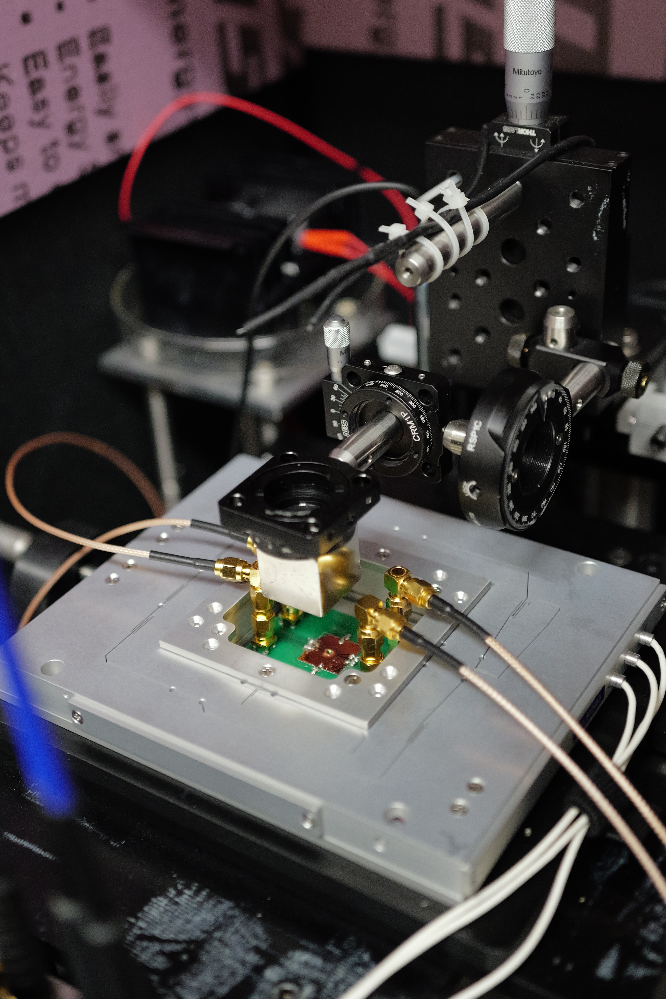
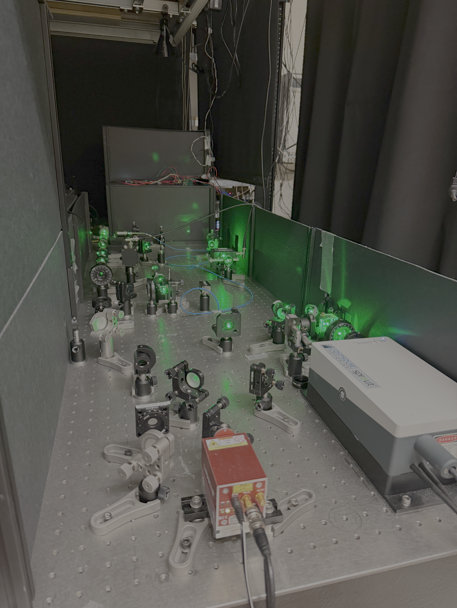

# NV2 Lab Manual

## Introduction

Welcome to the Quantum Engineering Group's NV2 lab manual. This experimental setup is used for controlling and imaging NV centers in diamond. This setup is designed to operate in several  modalities, both as a single and ensemble NV confocal microscope and as a widefield imaging system with a SPAD camera. This documentation covers the hardware assemblies, calibration procedures, and experimental protocols for operating the setup. The manual is organized into three main sections: {doc}`System Overview <system_overview/index>`, {doc}`Alignment & Calibration <calibration/index>`, and {doc}`Experiments & Applications <experiments/index>`. Also, in the {doc}`Appendix <appendix/index>` you can find an account of any major repairs and diagnostic tools for troubleshooting some common issues with the setup. This documentaion will assume basic familiary with NV center physics. For an in depth review on the topic, I recommend checking out the PhD thesis written by Masashi Hirose from QEG[^Hirose]. Other relevant resources are included in the {doc}`Appendix <appendix/index>`.

Some pictures of the setup are shown below. Most of the setup lives on or above the optical table, with the exception of the control electronics and computer. We will break down all of the important details on its construction and operation in the sections to come. 

```{raw} html
<figure style="margin: 1.5rem 0;">
  <div style="display: flex; gap: 0.75rem; align-items: center;">
    <div style="flex: 1; text-align: center;">
      
      <div style="font-size: 0.85em; margin-top: 0.25rem;">(a)</div>
    </div>
    <div style="flex: 1; text-align: center;">
      
      <div style="font-size: 0.85em; margin-top: 0.25rem;">(b)</div>
    </div>
  </div>
  <figcaption style="text-align: center; font-size: 0.9em; margin-top: 0.5rem;">
    Photos of the NV2 experimental setup. (a) Diamond and PCB mounted on the piezo stage inside the science box. (b) Excitation optics for imaging and fluorescence readout of NV centers.
  </figcaption>
</figure>
```

## Contact Info

| | |
|---|---|
| PhD student | Alex Ungar |
| Email | <ungar@mit.edu> |
| Lab | 26-311 |
| Office | 26-317 |
| PI | Prof. Paola Cappellaro |
| Lab website | <http://qeg.mit.edu/> |

```{toctree}
:maxdepth: 2
:titlesonly:

background/index
system_overview/index
calibration/index
experiments/index
appendix/index
```

[^Hirose]: M. Hirose, Quantum control of spin systems in diamond, PhD thesis, Massachusetts Institute of Technology, [2015]. <https://dspace.mit.edu/entities/publication/d0bbaba8-fa0c-4d2a-936f-7dc4b23bfc61> 
