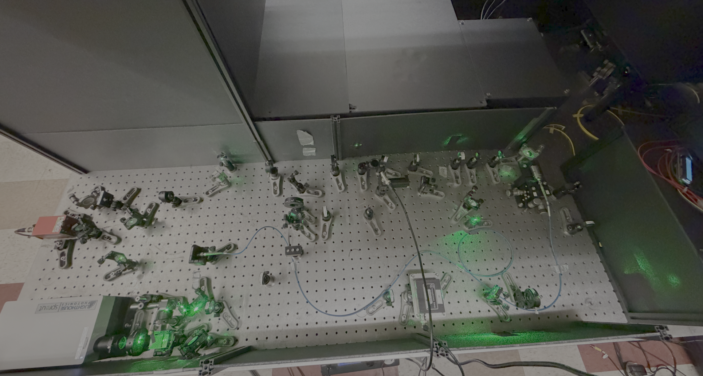
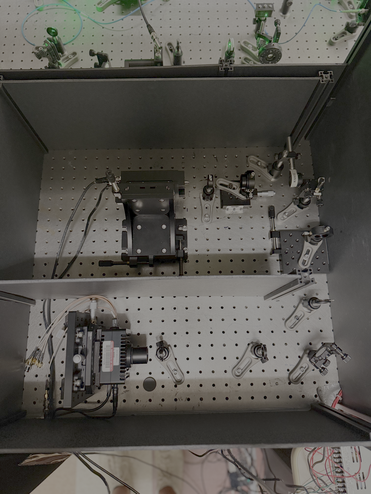

# Optics & Imaging

This page summarizes the construction of the optical setup, which operates as an NV fluorescence
microscope and performs optical initialization and readout of the NV spin state for pulse-sequence
control.

## Design Requirements

The design is based around the specifications of two essential components: a high-NA microscope objective and a single-photon detector.
Together they set the resolution and sensitivity needed to resolve single NVs down to the
diffraction limit and detect single-photon emission. The setup must also switch between confocal
and widefield imaging by adjusting the excitation beam profile at the objective focal plane and
routing the detection path to the corresponding detector (SPCM or SPAD array). Both detection
paths are co-aligned with the excitation focus at the objective focal plane.

For pulsed experiments on single NVs, the excitation laser must be modulated with a rise time on the order of
100 ns and achieve pulse durations on the order of 1 $\mu\text{s}$ for efficient spin polarization, with ~ 0.5 mW laser power before the objective. The
extinction ratio (leakage light when the laser is gated off) must exceed 40 dB to avoid
repolarization during microwave control. For widefield experiments, the excitation intensity over
the NV array must reach approximately the same intensity used for single-NV experiments,
where the light is focused to a diffraction-limited spot. This requires roughly 60 mW of power at
the sample (see {doc}`../calibration/optics_alignment` for how we arrived at this estimate).

## Setup Overview

{numref}`Figure %s <fig-optics-layout>` shows the full beam path from both excitation lasers,
the fiber coupling to the objective, and the two detection channels.

```{figure} ../_static/images/nv_optics_combined.png
:name: fig-optics-layout
:alt: Optics schematic
:width: 100%
:align: center

Schematic of the NV fluorescence microscope setup for confocal and widefield imaging.
```

```{raw} html
<figure style="margin: 1.5rem 0;">
  <!-- flex-grow = image aspect ratio (width/height), so both photos share one row at equal height -->
  <div style="display: flex; gap: 0.75rem; align-items: flex-start;">
    <div style="flex: 1.87 1 0; min-width: 0; text-align: center;">
      <a href="../_static/images/excitation_photo.png" target="_blank" rel="noopener"></a>
      <div style="font-size: 0.85em; margin-top: 0.25rem;">(a)</div>
    </div>
    <div style="flex: 0.75 1 0; min-width: 0; text-align: center;">
      <a href="../_static/images/detection_photo.png" target="_blank" rel="noopener"></a>
      <div style="font-size: 0.85em; margin-top: 0.25rem;">(b)</div>
    </div>
  </div>
  <figcaption style="text-align: center; font-size: 0.9em; margin-top: 0.5rem;">
    Photos of the excitation and collection optics outside the science box. (a) Excitation optics, with the science box at upper left and the collection box at upper right. (b) Collection optics: confocal path to the SPCM above and SPAD array path below.
  </figcaption>
</figure>
```

## Components

| Component | Model | Notes |
|---|---|---|
| Experiment laser | [Lighthouse Photonics Sprout G 5W](https://www.gophotonics.com/products/lasers/lighthouse-photonics/29-511-sprout-g-5w) | CW, 532 nm DPSS |
| Alignment laser | <a href="../_static/hardware/DLnsec_manual_V1.10.pdf" target="_blank" rel="noopener">Labs Electronics DLnsec</a> | Pulsed, 110 mW, 520 nm diode laser |
| AOM (Acousto-Optic Modulator) | IntraAction Corp AFM-804A1 | 80 MHz, 514 nm |
| Optical fiber | [Thorlabs P3-488PM-FC-2](https://www.thorlabs.com/polarization-maintaining-fcapc-fiber-optic-patch-cables?tabName=Overview) | Polarization-maintaining, FC/APC |
| Fiber collimator (laser side) | [Thorlabs CFC5-A](https://www.thorlabs.com/fcpc-adjustable-aspheric-collimators?tabName=Overview) | FC/PC adjustable aspheric collimator |
| Fiber collimator (objective side) | [Thorlabs RMS20X](https://www.thorlabs.com/item/RMS20X) | 20X Olympus Plan Achromat objective, 0.40 NA, 1.2 mm WD, used as an output coupler |
| Microscope objective | [Nikon CFI Plan Fluor 100X Oil](https://www.microscope.healthcare.nikon.com/products/optics/selector/comparison/-1832) | 1.3 NA — focuses excitation light and collects NV fluorescence |
| AOM telescope lenses | Thorlabs LA1422-A ($f_1$ = 400 mm), LA1422-A ($f_2$ = 40 mm) | Reduced beam size for faster switching |
| Objective telescope lenses | Thorlabs LA1422-A ($f_1$ = 40 mm), LA1509-A ($f_2$ = 100 mm) | Magnifies beam to match the objective aperture |
| Dichroic mirror | [Thorlabs DMLP567](https://www.thorlabs.com/item/DMLP567) | 567 nm cut-on |
| Photodetector | [Thorlabs DET36A](https://www.thorlabs.com/item/DET36A) | Si biased detector, 350–1100 nm; detects the excitation light reflected by the reflective ND filter |
| SPCM (Single-Photon Counting Module) | [Excelitas SPCM-AQRH-15-FC](https://www.digikey.com/en/products/detail/excelitas-technologies/SPCM-AQRH-15-FC/6235282) | Confocal detection |
| SPAD camera | <a href="../_static/hardware/SPC3_user_manual_2.2.0B.pdf" target="_blank" rel="noopener">Micro Photon Devices SPC3</a> | Widefield detection, 64x32 pixel array |

See {doc}`../appendix/documentations` for the full list of hardware manuals and spec sheets.

## Excitation Path

The two lasers serve different roles and have changed over the years. The setup originally relied
on a single high-power laser (Lighthouse Photonics Sprout, 5 W, 532 nm), shared with NV1. Repeated
stability problems with that laser's power supply motivated a switch to a pulsed, low-power laser
(DLnsec, 110 mW, 520 nm). The lower power DLnsec was sufficient for single-NV confocal experiments but could not reach the
power needed for widefield experiments. The Sprout was later reinstalled to run both confocal and
widefield experiments, while the DLnsec was kept for automated NV tracking since its
output is easily controlled through the Qudi interface.

Because the Sprout is CW, an AOM is used to modulate its output. The AOM is aligned in a
single-pass configuration — the setup has enough free-space path length to isolate the 0th-order
beam with an iris — and the two AOM telescope lenses match the beam size for best efficiency. An additional $f = 750$ mm lens corrects the beam collimation before the fiber coupler.
The DLnsec, in contrast, is directly modulated by a TTL signal from the OPX+. Its output beam is
elliptical (stretched along one axis relative to the other). This is partially corrected for by using a
2:1 anamorphic prism pair. A quarter-waveplate and half-waveplate tune the power reflected off the polarizing beam splitter,
compensating for a small amount of circular polarization present in the beam.

The optical fiber in the excitation stage serves two purposes. First, as a single-mode fiber, it spatially filters the
beam to produce a clean Gaussian profile at its output. Second, it decouples the downstream
alignment (objective and sample) from the upstream laser-source alignment, which we have had to change
several times over past few years. When the high-power laser was reinstalled, only the
fiber coupling needed to be re-aligned, keeping the objective-side alignment untouched. Both lasers
are combined onto the same fiber with a polarizing beam splitter (PBS), each with its own pair of
steering mirrors for independent alignment (see {doc}`../calibration/optics_alignment` for the
exact procedure). The mirror pair closest to the fiber is fixed once both lasers are aligned to it. Each laser then has one additional pair of mirrors to optimize the coupling (for the DLnsec, the PBS itself serves as one of these).

## Objective & Sample Interface

For confocal imaging, the excitation light out of the fiber is collimated and magnified before the objective using two lenses as a telescope. Since we use the high power Sprout laser for both confocal and widefield measurements, there is an ND filter located on a flip mount (not shown in the schematic) to attenuate the power accordingly. The focal lengths of the lenses for the telescope are chosen to magnify the beam to match the back aperture of the objective, $D$. We use a Nikon CFI
Plan Fluor 100X Oil, 1.3 NA objective. Its effective focal length is set by the magnification
$M = 100$ and the focal length of the Nikon tube lens it is designed for, $f_\text{tube} = 200$ mm:

$$
f_\text{obj} = \frac{f_\text{tube}}{M} = \frac{200~\text{mm}}{100} = 2~\text{mm}.
$$

From geometric optics, the objective aperture is $D = 2\times\text{NA}\times f_\text{obj} \approx
5.2$ mm. The green light enters the science box and is reflected off the dichroic mirror and sent through the objective ({numref}`Figure %s <fig-objective-schematic>`). 
The diamond sample is mounted on a cover glass patterned with a microwave stripline (also referred to as a coplanar
waveguide or CPW; see {ref}`Coplanar Waveguide & PCB <cpw-design>`). Immersion oil is placed between the objective's front lens and the cover glass. The
objective's working distance (WD) is 0.16 mm for a 0.17 mm cover glass, so the cover glass surface
closest to the objective sits 0.16 mm away when the objective is focused at the diamond surface
(the CPW itself is only $\sim 500$ nm thick, negligible on this scale).

```{figure} ../_static/images/objective.png
:name: fig-objective-schematic
:alt: Objective and sample schematic
:width: 60%
:align: center

Schematic of the objective, cover glass (CG), and diamond sample arrangement.
```

The current NV2 sample has NVs implanted at an approximate depth of 20 nm — well below the
diffraction limit -- so the NV layer can be treated as effectively located at the diamond surface. To position the
diamond surface at the objective focal plane, a piezo scan along the axial (Z) direction records
the NV fluorescence profile on the SPCM. We use the brighter ensemble fluorescence as a starting point and once the focus is found, we perform a 2D scan to image the single NV arrays (for more details see {doc}`../calibration/sample_mounting`).

For a Gaussian beam matched to the objective aperture, the $1/e^2$ spot diameter at the focal plane
is given by[^Thorlabs]

$$
s \approx \frac{1.83\,\lambda}{2\,\text{NA}} \approx 374~\text{nm}.
$$

Both the optical initialization efficiency and the readout signal-to-noise of a single NV or
ensemble depends on the intensity profile, set by the incident power
and focal-plane spot size. The average intensity optimized for a single NV also sets
the total illumination power required for widefield SPAD measurements over the NV array.

## Confocal Detection Path

We can approximate the NV fluorescence as originating from a point-source with emission over a broad phonon-sideband extending from the 637 nm zero-phonon line out to roughly 800 nm at room temperature[^wiki1]. The
fluorescence returns along the excitation path through the objective, passes through the
dichroic, and is filtered by a longpass filter to remove residual excitation light. The lateral
point-spread-function (PSF) resolution of the objective is given by[^Leica]

$$
\text{FWHM} \approx \frac{0.51\,\lambda}{\text{NA}} \approx 270~\text{nm} \quad (\sim 460~\text{nm},\ 1/e^2\text{ diameter}).
$$

The collected fluorescence is split into two paths: one for confocal imaging using the SPCM, and one for widefield imaging
with the SPAD array. For the confocal path, the light is first imaged onto a pinhole to reject
out-of-focus background and improve contrast. A free-space confocal detection path typically uses
two lenses after the pinhole — one to collimate the light after the pinhole, and one to focus that
light onto the detector. Alternatively, a fiber-coupled path needs only a single lens after the
objective, since the fiber itself acts as the pinhole. This setup uses free-space detection but,
for improved space efficiency, we use only a single lens after pinhole which directly focuses the light onto the detector. The position of this lens is set according to following equation derived using the ray optics approximation for a thin lens[^SalehTeich][^Approx]

$$
\frac{1}{z} + \frac{1}{z'} \approx \frac{1}{f},
$$

as shown in {numref}`Figure %s <fig-collection-rays>`.

```{figure} ../_static/images/nv_collection_rays.png
:name: fig-collection-rays
:alt: Collection path
:width: 60%
:align: center

Schematic of the collection path for the confocal microscope.
```

The lens after the pinhole has a focal length of 100 mm, giving an overall magnification of 50X
from the objective's focal plane to this lens's image plane. Assuming a Gaussian diffraction-limited
spot, the spot size at the image plane is 46 $\mu\text{m}$. A 50 $\mu$m pinhole rejects light
collected from outside the diffraction-limited spot. With the added pinhole, the axial resolution of the
confocal PSF is approximately

$$
\frac{1.4\,\lambda\, n}{\text{NA}^2} \approx 1~\mu\text{m}.
$$

The axial and lateral PSFs are characterized and compared with these values in the {doc}`Confocal Imaging <../experiments/confocal_imaging>` section.

The second lens provides a magnification of

$$
M \approx \left| \frac{f}{z-f} \right| = \frac{2}{3},
$$

so the spot size at the detector is $\approx 20~\mu\text{m}$, comfortably within the SPCM's 180
$\mu$m active-area diameter.

## Widefield / SPAD Detection Path

The widefield path images the NV fluorescence onto the SPAD camera using a single lens. The array has
64$\times$32 pixels, each 150 $\mu$m wide ({numref}`Figure %s <fig-spad-array>`). To resolve
individual implantation spots (spaced 1 $\mu$m apart in the sample) with at least two pixels of
separation the imaging path needs 300X magnification, achieved with a 600 mm imaging lens. The image of the NV array then becomes a checkerboard pattern. At this magnification, the objective's full
field of view ($\sim 50~\mu\text{m}$) fits within the sensor area. Given the available laser power,
only a single 5$\times$5 NV array (spanning 9$\times$9 pixels) is illuminated at a time.

To illuminate the full array, collimated light is focused at the objective's back aperture using a
flip-mounted lens (allowing the setup to switch between confocal and widefield modes). This lens
has a 1 m focal length. Combined with the objective as a telescope, it is designed to produce a collimated beam
at the sample plane with a 10 $\mu$m diameter. This diameter is larger than the span of the array but chosen so the illuminated area over the array has a more uniform power distribution (with a tradeoff of having to use more total laser power to match the optimal intensity per NV). We find after alignment that the beam diameter is approximately 7.5 $\mu$m (see the {doc}`alignment <../calibration/optics_alignment>` section).

```{figure} ../_static/images/SPAD_array.png
:name: fig-spad-array
:alt: SPAD array
:width: 60%
:align: center

The SPAD array camera from Micro Photon Devices. Image adapted from Wang et al.[^Wang2023]
```

[^Thorlabs]: Thorlabs, *Spot Size Tutorial*, <https://www.thorlabs.com/high-power-microspot-r-focusing-objectives-for-vis-and-nir-lasers?tabName=Spot%20Size>
[^wiki1]: Wikipedia, *Nitrogen-vacancy center*, <https://en.wikipedia.org/wiki/Nitrogen-vacancy_center>
[^Leica]: Leica Microsystems, *Microscope Resolution: Concepts, Factors and Calculation*, <https://www.leica-microsystems.com/science-lab/life-science/microscope-resolution-concepts-factors-and-calculation/>
[^SalehTeich]: B. E. A. Saleh and M. C. Teich, *Fundamentals of Photonics*, 3rd ed., Wiley, 2019.
[^Approx]: This applies the ray-optics approximation, valid since $z - f \gg z_0$, where $z_0$ is the Rayleigh range.
[^Wang2023]: G. Wang, F. Madonini, B. Li, C. Li, J. Xiang, F. Villa, and P. Cappellaro, *Fast Wide-Field Quantum Sensor Based on Solid-State Spins Integrated with a SPAD Array*, Advanced Quantum Technologies, vol. 6, no. 9, 2023. <https://doi.org/10.1002/qute.202300046>
