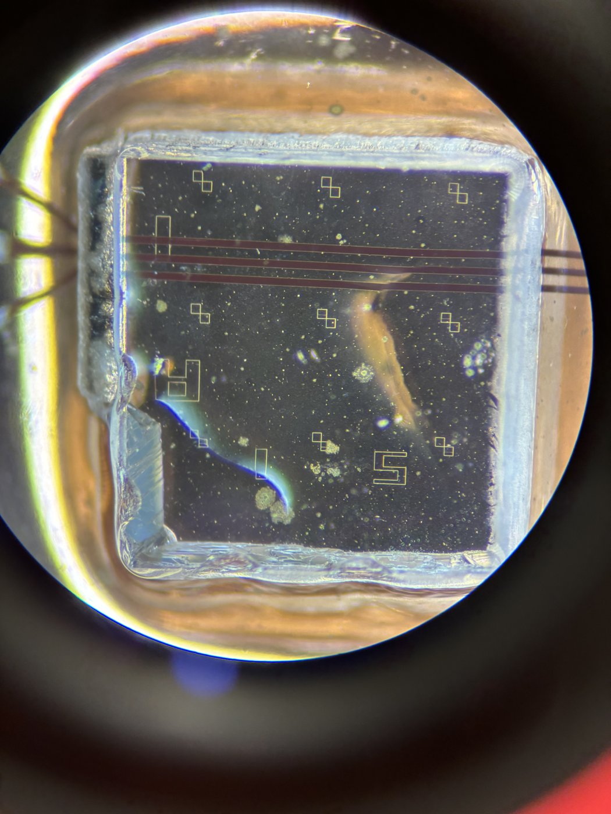
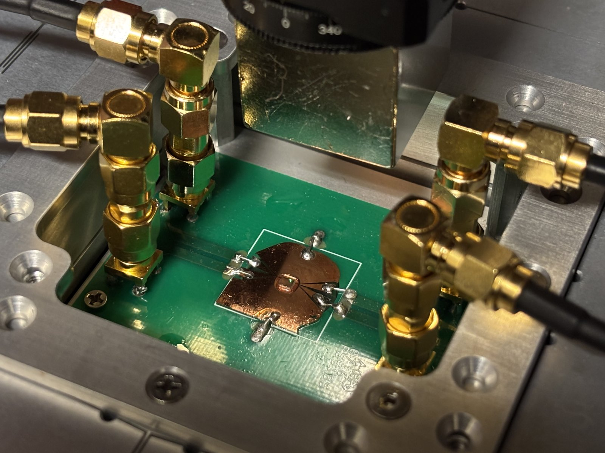

# Microwave & RF Electronics

This page describes the electronics that generate, amplify, and deliver the microwave (MW) and
radio-frequency (RF) pulses used for coherent spin control of the NV electronic spin, the dark
electronic spins in the sample (referred to here as X spins; see {ref}`Cooper et al., 2020 <pub-cooper2020>`), and nearby nuclear spins.

## Design Requirements

The primary function of the MW electronics is to control the NV spin state. The spin state is
manipulated with resonant MW pulses: the amplitude of the oscillating magnetic field at the NV resonance
sets how fast the spin is driven (its Rabi frequency $\Omega$), and the phase of the pulse sets
the axis of rotation on the Bloch sphere. For almost all of our experiments we drive the
$m_s = 0 \leftrightarrow m_s = -1$ transition, the lower frequency of the two NV spin transitions,

$$
f_{-} = D - \gamma_e B_z,
$$

where $D \approx 2.87$ GHz is the zero-field splitting, $\gamma_e \approx 2.8$ MHz/G is the
electron gyromagnetic ratio, and $B_z$ is the bias field along the NV axis. The bias magnet is usually positioned so that this transition spans roughly 1.9–2.9 GHz ($B_z$ up to $\sim 350$ G).

The Rabi frequency is proportional to the MW field amplitude, and therefore to the square root of
the delivered power, $\Omega \propto B_1 \propto \sqrt{P}$. Typical single-qubit gate times
(like a $\pi$ or $\pi/2$ pulse) range from $\sim 100$ ns to 1 $\mu$s depending on the MW power. The maximum Rabi frequency is limited by
how much current can flow through the MW stripline (see {ref}`Coplanar Waveguide & PCB <cpw-design>`
for details on the coplanar waveguide design). The measured limit is about 27 dBm CW near $f \approx D$, which agrees
with the stripline's measured maximum DC current of 0.15 A (assuming the thickness of the stripline is comparable to the skin depth for the conductor). For a matched $Z_0 = 50~\Omega$ line, the peak
current at 27 dBm (0.5 W) is

$$
I_\text{peak} = \sqrt{\frac{2P}{Z_0}} = \sqrt{\frac{2 \times 0.5~\text{W}}{50~\Omega}} \approx 0.14~\text{A}.
$$

*Add: link to the stripline failure-mode testing log.*

Beyond NV control, the setup is configured for several control applications and defect systems.
It covers three frequency bands, each with its own amplifier chain:

| Chain | Target spins | Frequency range | Amplifier bandwidth |
|---|---|---|---|
| MW-NV | NV electronic spin ($m_s = 0 \leftrightarrow \pm 1$) | 1.9–3.9 GHz | 1.8–4.0 GHz |
| MW-X | Dark electronic spins (X or P1) | $\lesssim 1$ GHz | 20–1000 MHz |
| RF-n | NV and X nuclear spins (¹⁵N, ¹H) | 0–15 MHz | 0.1–200 MHz |

For a dark electronic spin with $g \approx 2$, the resonance frequency is around $f_X \approx \gamma_e B_z \pm A/2$ where the hyperfine shifts can be up to 100 MHz for the P1 center (¹⁵N, nuclear spin ½, in our implanted sample),
which reaches $\sim 1$ GHz over the same field range. Strictly speaking the field should be slightly reduced for the higher P1 resonance to be within the amplifier bandwidth. Lastly, not shown in the schematic, the
setup can also drive strong magnetic-field gradients using a high-power MOSFET switch connected to both stripline channels (details on this configuration in *Add: link to the gradient switch design and implementation*).

## Setup Overview

{numref}`Figure %s <fig-mw-chain>` shows the full MW/RF chain, from the OPX+ analog outputs to
the stripline PCB.

```{figure} ../_static/images/mw_chain_schematic.png
:name: fig-mw-chain
:alt: MW/RF chain schematic
:width: 100%
:align: center

Schematic of the MW/RF chain, configured for control of all three spin species. Thin lines are
low-power signals from the OPX+ and SG384; thick lines are amplified MW/RF signals delivered to the
stripline. The dotted path is the termination used in place of the X chain when only the NV and
nuclear spins are driven and used similarly for other configurations with two tone control.
```

## Components

| Component | Model | Notes |
|---|---|---|
| FPGA | [Quantum Machines OPX+](https://www.quantum-machines.co/products/opx/) | 4 analog outputs, 2 analog inputs, 10 digital outputs; 1 GS/s, 16-bit, 400 MHz bandwidth, used as AWG, TTL driver, and SPCM signal acquisition |
| Signal generators (×2) | [SRS SG384](https://www.thinksrs.com/products/sg380.html), Opt. 03 | DC–4.05 GHz; external IQ modulation for carriers 400 MHz–4.05 GHz |
| NV amplifier | [Mini-Circuits ZHL-16W-43-S+](https://www.minicircuits.com/pdfs/ZHL-16W-43-S+.pdf) | 1.8–4.0 GHz, 45 dB gain, 16 W |
| X amplifier | [Mini-Circuits ZHL-20W-13+](https://www.minicircuits.com/pdfs/ZHL-20W-13+.pdf) | 20–1000 MHz, 50 dB gain, 20 W |
| RF amplifier | [Mini-Circuits LZY-22+](https://www.minicircuits.com/pdfs/LZY-22+.pdf) | 0.1–200 MHz, 43 dB gain, 30 W |
| RF switch | [Mini-Circuits ZASWA-2-50DR+](https://www.minicircuits.com/pdfs/ZASWA-2-50DR+.pdf) | Absorptive SPDT, DC–5 GHz, integrated TTL driver |
| Low-pass filter | [Mini-Circuits BLP-30+](https://www.minicircuits.com/pdfs/BLP-30+.pdf) | DC–32 MHz passband, 0.5 W max input |
| Attenuators | Miscellaneous Mini-Circuits | 3 dB (Q2), 16 dB (RF chain), 2 × 20 dB (stripline terminations) |
| Terminations | Mini-Circuits ANNE-50+ | 50 Ω |
| MW stripline | Custom two-channel CPW on cover glass, custom PCB with 4 SMA connectors | See {ref}`Coplanar Waveguide & PCB <cpw-design>` |

See {doc}`../appendix/documentations` for the full list of hardware manuals and spec sheets.

## Pulse Generation (QM OPX+)

The QM OPX+ is the central instrument for generating the pulsed MW and RF waveforms, providing the function of an arbitrary waveform generator (AWG) among other capabilities. Our unit has
four analog outputs, two analog inputs, and ten digital outputs. The analog outputs sample at
1 GS/s with 16-bit resolution, a 400 MHz (3 dB) bandwidth, and a 1 V peak-to-peak swing into
50 Ω. The pulse processor runs on a 250 MHz clock, so pulse timing has 4 ns granularity, with a
minimum pulse length of 16 ns[^OPX].

Pulse sequences are written in QUA, Quantum Machines' pulse-level programming language, from a
Python environment. Each program is compiled and executed in real time on the OPX+'s FPGA-based
pulse processor (see {doc}`Software Organization <software>`). The OPX+ also generates the laser (and RF switch)
TTL pulses on its digital outputs and reads in the SPCM signal on an analog input, so laser
gating and photon acquisition are synchronized internally with the pulse sequence.

## IQ Modulation

The NV and X chains each use two analog channels, one for the in-phase (I) and one for the
quadrature (Q) waveform (I1/Q1 for the NV, I2/Q2 for X). These drive the external IQ inputs of an
SRS SG384 signal generator. Its internal IQ modulator multiplies each waveform by its carrier (the
local oscillator, LO), with the two LO copies 90° apart, and combines the products. For
intermediate-frequency (IF) waveforms from the OPX+

$$
s_I(t) = A_\text{IF}\cos(\omega_\text{IF} t + \phi), \qquad s_Q(t) = A_\text{IF}\sin(\omega_\text{IF} t + \phi),
$$

and dimensionless LO quadratures $s_\text{LO}(t) = \cos(\omega_\text{LO} t)$ and
$\bar{s}_\text{LO}(t) = \sin(\omega_\text{LO} t)$, the upconverted MW signal is

$$
s_\text{MW}(t) \propto s_I(t)\,s_\text{LO}(t) - s_Q(t)\,\bar{s}_\text{LO}(t)
= A_\text{IF}\cos\!\left[(\omega_\text{LO} + \omega_\text{IF})\,t + \phi\right],
$$

where $\omega = 2\pi f$. The output is a single tone at the upper sideband, $f_\text{LO} + f_\text{IF}$,
and it carries the phase $\phi$ of the IF waveforms. Adding the two products instead of subtracting
them selects the lower sideband, at $f_\text{LO} - f_\text{IF}$ with phase $-\phi$. Unlike a single
mixer, which splits its output equally between the two sidebands, the two IQ paths add on one
sideband and cancel on the other. 

The phase $\phi$ of the IF waveforms therefore sets the phase of the MW pulse (the rotation axis),
while the IF amplitude $A_\text{IF}$ can be used to control power (the Rabi frequency). The exact power depends on both $A_\text{IF}$ (set in volts) and the SG384 LO amplitude (set in dBm). The SG384 IQ inputs are
50 Ω with a full scale of $\sqrt{s_I^2 + s_Q^2} = 0.5$ V, matching the ±0.5 V output range of the OPX+, and the modulation
bandwidth is 200 MHz[^SG384]. Any phase and amplitude imbalance between the I and Q tones (from cables or other connections) will produce an image sideband at $f_\text{LO} - f_\text{IF}$, and any DC offsets from the mixer will lead to LO leakage. These are corrected for using QUA calibration software (see {doc}`IQ Calibration <../calibration/iq_calibration>`).

The SG384's external IQ modulation only works for carrier frequencies between 400 MHz and
4.05 GHz[^SG384]. The NV band is well inside this range, but the X chain's LO must be set at or
above 400 MHz.

## NV and X Chains

The SG384 outputs are amplified by a Mini-Circuits ZHL-16W-43-S+ for the NV band (MW-NV) and a
ZHL-20W-13+ for the X band (MW-X). Both amplifiers can deliver far more power (+42 and +43 dBm
saturated) than the $\sim 27$ dBm the stripline tolerates, so in practice the stripline sets the
power limit, not the amplifiers. For added safety,
it would be worthwhile adding attenuators before the amplifier based on the maximum output power from the IQ modulated signal from the SG384, so that the power never exceeds this limit. For a reference on CPW input power to Rabi frequency see {ref}`Coplanar Waveguide & PCB <cpw-design>`.
```{warning}
With 45–50 dB of amplifier gain, an SG384 output of only about −20 dBm already reaches the
stripline's $\sim 27$ dBm limit. Check the power delivered to the stripline before increasing the
SG384 output level or the pulse amplitudes in the QUA configuration.
```

## RF Nuclear Spin Chain

Nuclear spin frequencies are well within the OPX+ output bandwidth (highest frequency set by the X1 hydrogen spin at around 14 MHz; see {ref}`Ungar et al., 2025 <pub-ungar2025>`), so the RF pulses
are synthesized directly by the OPX+ without upconversion. With all four analog outputs already
used by the NV and X chains, we reuse the X chain's I channel (I2) for RF pulses, since RF and X
pulses are never applied simultaneously. A tee splits I2 between the X-chain SG384 and the RF chain.
The RF waveform therefore also reaches the X-chain SG384 during RF pulses, but the resulting upconverted
output is far off resonance from the X spins and has no effect.

Because of the tee, the OPX+ output on I2 drives two 50 Ω inputs in parallel (25 Ω), which reduces
its voltage to 2/3 of the value into a single matched load ($20\log_{10}(2/3) \approx -3.5$ dB). A
3 dB attenuator on Q2 applies nearly the same reduction to the Q channel, keeping the I and Q
amplitudes into the X-chain SG384 balanced. The small remaining imbalance is corrected for in software by the IQ
calibration settings.

A TTL output from the OPX+ gates a ZASWA-2-50DR+ switch at the input of the RF chain. The
switch passes I2 into the RF chain only during RF pulses, which keeps the X waveforms out of the
RF chain and stops other low-frequency noise from passing through the amplifier onto the
stripline. The LZY-22+ has a built-in blanking input, but its 64 ms turn-on time is far too slow
to gate individual pulses[^LZY]. After the switch, the signal is amplified by the LZY-22+
(0.1–200 MHz, 43 dB gain) and passes through a BLP-30+ low-pass filter before reaching the
stripline; the filter passes DC–32 MHz and rejects 61–200 MHz by more than 40 dB.

A 16 dB attenuator before the amplifier limits the maximum power of the RF signal to below 0.5 W
(27 dBm), the limit of both the stripline and the BLP-30+. At full OPX+ output (+4 dBm into
50 Ω), the tee (−3.5 dB), the switch insertion loss (−1.3 dB), the 16 dB attenuator, and the
43 dB amplifier gain give a maximum of about +26 dBm at the stripline. 

(cpw-design)=
## Coplanar Waveguide & PCB

The MW and RF fields are delivered to the sample by a custom two-channel coplanar waveguide (CPW),
originally designed by Alex Cooper and related to the ultra-broadband CPW of Jia et al.[^Jia2018]. The
goal of the design is uniform transmission across a wide bandwidth, covering both the NV and
dark-spin bands. The CPW has two central conductors, one for each channel, between two ground planes
({numref}`Figure %s <fig-cpw-layout>`). Each central conductor is 2.2 mm wide at the edge of the
cover glass and tapers to 75 µm over the central 5 mm of the waveguide. There, the gap between the
two central conductors as well as the gap between each conductor and its ground plane are both 25 µm. The
NVs are imaged through the central 25 µm gap between the conductors, where the NVs are equidistant from both conductors, so either channel drives them equally.

The key design criterion is maximizing AC current density through the stripline below the maximum limit before burning out the conductor (as the magnetic field strength scales with I/r). This takes into account both current carrying capacity limited by the cross-sectional area of the channel as well as the impedance match over the target bandwidth between the PCB and the stripline interface. Proper matching is achieved through the tapered profile and can be simulated with COMSOL. Empirically, with an input power of 22 dBm at 2.8 GHz we measure an NV Rabi frequency of approximately 18 MHz.

This is consistent with a rough estimate. At 22 dBm the peak current is
$I = \sqrt{2P/Z_0} \approx 80$ mA. Treating the conductor as a thin wire at its edge, a distance
$r \approx 12.5$ µm from NVs at the center of the gap, the MW field is

$$
B_1 \approx \frac{\mu_0 I}{2\pi r} \approx 1.3~\text{mT}~(13~\text{G}).
$$

Only the component of $B_1$ perpendicular to the NV axis drives the spin. For the
$m_s = 0 \leftrightarrow -1$ transition, the Rabi frequency (in frequency units, with
$\gamma_e \approx 2.8$ MHz/G) is

$$
\Omega = \frac{\gamma_e B_1 \sin\theta}{\sqrt{2}} \approx 25~\text{MHz} \times \sin\theta,
$$

where $\theta$ is the angle between $B_1$ and the NV axis. At the center of the gap the field points
out of the plane of the CPW, normal to the diamond's (001) surface. The diamond is mounted with its
[110] edges perpendicular to the CPW channels. All four NV orientations (along $\langle 111 \rangle$)
make the same angle with [001], $\cos\theta = 1/\sqrt{3}$ ($\theta \approx 54.7°$), so the MW drives
every orientation equally, with $\sin\theta = \sqrt{2/3} \approx 0.82$ and $\Omega \approx 21$ MHz. The thin-wire approximation places all of
the current at the conductor edge, so it slightly overestimates the field.

```{figure} ../_static/images/cpw_layout.png
:name: fig-cpw-layout
:alt: CPW layout
:width: 100%
:align: center

CPW layout on the 18 × 18 mm cover glass, drawn from the GDS file. Copper is shown in gold and the
gaps (bare cover glass) in light gray. The inset shows the center of the
waveguide, where the two 75 µm central conductors are separated by the 25 µm imaging gap.
```

The CPW is patterned onto an 18 × 18 × 0.17 mm cover glass by direct-write UV lithography and
e-beam evaporation of 500 nm of Cu (on a 10 nm Ti adhesion layer), followed by lift-off. The full
process and the design files are in {doc}`CPW Fabrication <../appendix/cpw_fabrication>`. The Cu
film is thinner than the skin depth at all of our operating frequencies,

$$
\delta = \sqrt{\frac{\rho}{\pi f \mu_0}} \approx 1~\mu\text{m} \quad \text{at } f = 4~\text{GHz},
$$

for copper ($\rho \approx 1.7 \times 10^{-8}~\Omega\,\text{m}$), so the current flows through the
full thickness of the film.

The cover glass is mounted and soldered onto a custom PCB, designed by Mo Chen, with four SMA
connectors, one at each end of the two channels. The ends of the central conductors and the ground
planes are soldered to pins on the PCB at the edges of the cover glass.

```{raw} html
<figure style="margin: 1.5rem 0;">
  <div style="display: flex; gap: 0.75rem; align-items: flex-start; justify-content: center; flex-wrap: wrap;">
    <div style="text-align: center;">
      
      <div style="font-size: 0.85em; margin-top: 0.25rem;">(a)</div>
    </div>
    <div style="text-align: center;">
      
      <div style="font-size: 0.85em; margin-top: 0.25rem;">(b)</div>
    </div>
  </div>
  <figcaption style="text-align: center; font-size: 0.9em; margin-top: 0.5rem;">
    (a) Diamond sample mounted on the CPW cover glass, viewed through a microscope eyepiece. The narrow section of the CPW runs horizontally across the diamond. (b) CPW cover glass soldered onto the PCB in the sample mount, with the four SMA cables connected. The objective sits below the sample; the mount above it holds the permanent bias magnet.
  </figcaption>
</figure>
```

## Stripline Connections

{numref}`Figure %s <fig-mw-chain>` shows the configuration for experiments in which all three spins are controlled within the same pulse sequence. The NV and X amplifiers drive opposite ends of the same stripline (Ch1), and the RF
chain drives Ch2. Since the RF drive has the highest power requirements, it is connected to its own CPW channel and terminated into 50 Ω through a 20 dB attenuator.

Connecting both the NV and X amplifiers to one stripline is certainly not optimal, since each
amplifier's output is delivered into the other amplifier's output port. It is a workaround for not
having a high-power combiner covering both frequency bands. Both amplifiers are protected against
reflected power: the ZHL-16W-43-S+ is rated to survive an open or short load at full CW output, and
the ZHL-20W-13+ survives a full mismatch as long as its input power stays below −13 dBm[^ZHL20]. At the power levels allowed by the stripline, both amplifiers operate far below these limits.

For experiments that don't require driving all three spins, the connections can be changed, since
the two striplines are equivalent. For example, for NV + nuclear spin experiments the X chain is
disconnected and Ch1 is terminated through a second 20 dB attenuator into 50 Ω (dotted path in
{numref}`Figure %s <fig-mw-chain>`).

[^OPX]: Quantum Machines, *OPX+ Specifications*, document v4.0 (QOP firmware v2.2).
[^SG384]: Stanford Research Systems, *SG380 Series RF Signal Generators* datasheet, <https://www.thinksrs.com/products/sg380.html>
[^LZY]: Mini-Circuits, *LZY-22+ High Power Amplifier* datasheet, <https://www.minicircuits.com/pdfs/LZY-22+.pdf>
[^ZHL20]: Mini-Circuits, *ZHL-20W-13+ High Power Amplifier* datasheet, <https://www.minicircuits.com/pdfs/ZHL-20W-13+.pdf>
[^Jia2018]: W. Jia, Z. Shi, X. Qin, X. Rong, and J. Du, *Ultra-broadband coplanar waveguide for optically detected magnetic resonance of nitrogen-vacancy centers in diamond*, Review of Scientific Instruments, vol. 89, 064705, 2018. <https://doi.org/10.1063/1.5028335>
